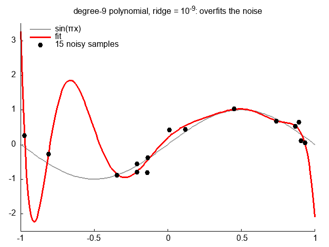

#+title: cl-linear-regression

Linear and ridge regression in Common Lisp: least squares with any number of outputs, on all rows or a
subset, solved by Gaussian elimination with partial pivoting.

A degree-9 polynomial fitted to 15 noisy samples of sin(πx), the ridge penalty swept from 10^-9 to 10^2: with almost
no penalty it overfits the noise, around 10^-3 it follows the signal, and as the penalty grows the weights shrink
until the fit is flat at the samples' mean (the intercept is not penalized). Each frame is one =lr:fit= on the
features x, x^2, ... x^9 and one =lr:predict=.

* Use

#+begin_src lisp
(ql:quickload "cl-linear-regression")
(let ((w (lr:fit x y)))          ; X: rows x inputs, Y: rows x outputs (a vector for one output)
  (lr:predict w x)               ; rows x outputs
  (lr:squared-errors x y w))     ; each row's |prediction - y|^2
#+end_src

- =(lr:fit x y &key ridge rows intercept penalize-intercept)=: the weights =W= minimising
  =|[X 1] W - Y|^2 + ridge |W|^2=, an =(inputs + 1) x outputs= matrix, the last row the intercept.
  - =ridge= (0): the ridge penalty. With 0 it is ordinary least squares, and collinear inputs make the system
    singular (an error).
  - =rows= (all): the row indices to fit on, a list or vector, so subsets need no copy of the data.
  - =intercept= (t): fit an intercept (a column of ones); with =nil=, =W= has one row per input.
  - =penalize-intercept= (nil): whether =ridge= also applies to the intercept.
- =(lr:predict w x)=: the predictions for each row of =x=.
- =(lr:squared-errors x y w)=: each row's squared error under =w=.
- =(lr:solve a b)=: =X= with =A X = B=.

Inputs may be any real arrays; matrices of =double-float= are used without copying.

* The animation

=demo/demo.lisp= draws the samples and fits the polynomial at each penalty, writing =demo/samples.dat= and
=demo/fits.dat=; =demo/ridge.gp= draws them with gnuplot as =demo/ridge.gif= (ImageMagick holds the last frame):

#+begin_src sh
cd demo && sbcl --script demo.lisp && gnuplot ridge.gp
#+end_src
